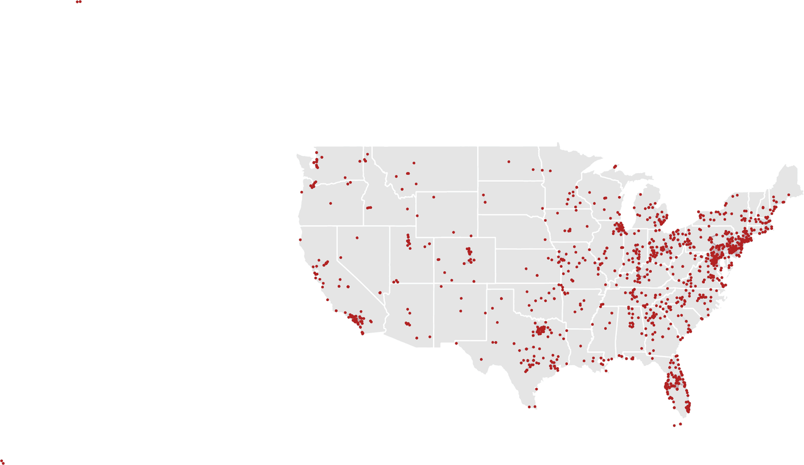
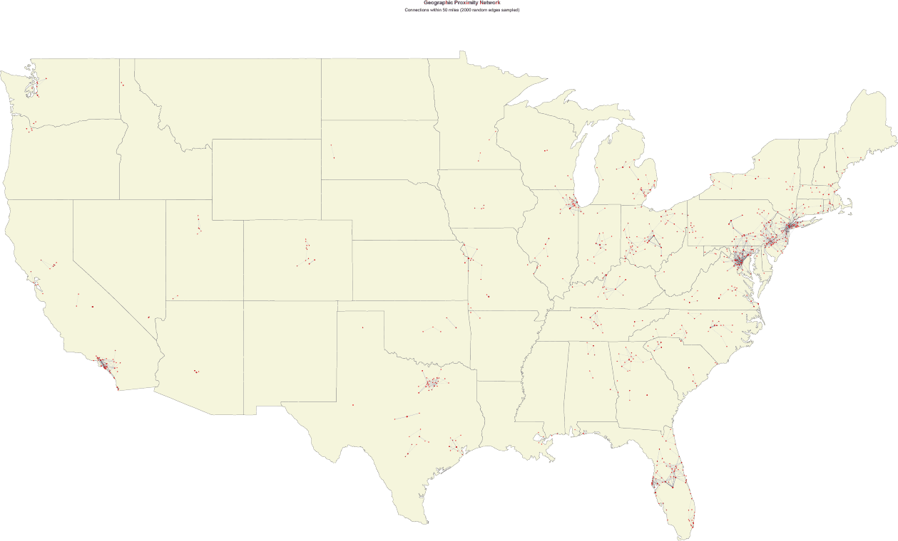
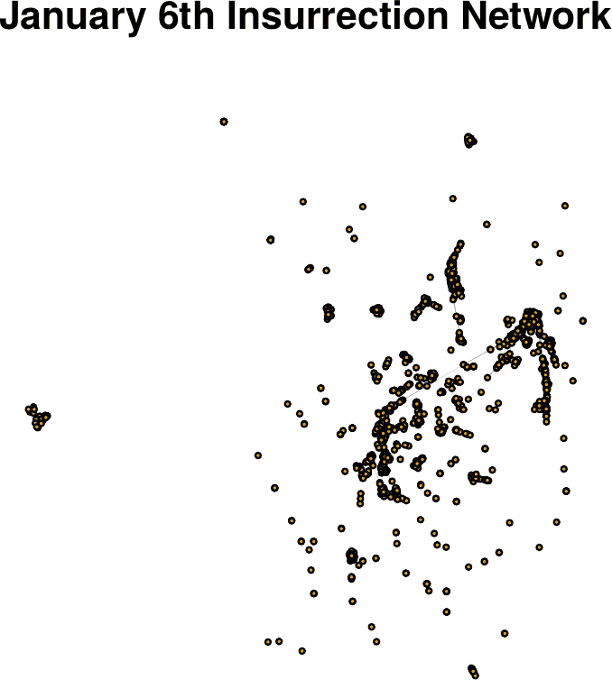

## 1. Purpose of the study

On January 6, 2021, thousands of Americans stormed the U.S. Capitol in an insurrection against the United States government. The event is often described as unprecedented and as a product of online conspiracy and polarized media. That account implies geography should not matter: if the mobilizing space was entirely digital, participants could come from anywhere.

This study tests that assumption. It asks whether geographic availability still shaped who chose to take part. Like many protests, biographical availability, and geographic space in particular, may remain a main mechanism behind participation even when organizing happens online. Understanding how and why people join protests is a core question for social network analysis, and January 6 offers a new case for examining how these mechanisms shape human decisions.

## 2. Methodology

**Data collection.** I collected publicly available information from NPR's database of people charged in connection with January 6: each person's name, hometown, and charges. I scraped every page of the database with ParseHub. A person was included if NPR listed their name and information. The database was updated as the Department of Justice filed new charges, so the sample reflects one point in time.

**Limitation of the sample.** Inclusion depends on being charged. A significant number of people who took part but were never charged are missing, so the data describe defendants, not all participants.

**Geocoding and network construction.** Each defendant's hometown was assigned coordinates in R, and each defendant was coded as a node. Two defendants share an edge if their hometowns are within 50 miles of each other. The 50-mile threshold reflects the study's assumption: if two people living that close both specifically chose to travel to Washington, D.C., on January 6, their decisions may be connected through personal relationships, shared geographic availability, or another mechanism the network could reveal.

The final dataset contains 1,575 defendants. Of these, 1,523 have at least one neighbor within 50 miles and appear in the edge list; the remaining 52 are isolates. Edges measure spatial proximity, not confirmed acquaintance or coordination.

## 3. Where defendants came from

Figure 1 plots every geocoded defendant at their hometown. Even before any ties are drawn, the pattern is uneven. Defendants concentrate along the East Coast, in the Mid-Atlantic corridor nearest Washington, D.C., and in a few metropolitan pockets elsewhere: southern Florida, the Dallas–Fort Worth area, greater Los Angeles, Chicago, and Ohio.

## 4. The proximity network

Figure 2 places each node at its real coordinates and draws a random sample of 2,000 ties, since the full network has more than 16,000. The outline of the country appears from the nodes alone, and the contrast between east and west is clear. In the western United States, defendants form small pockets and sub-networks disconnected from the rest. Moving east toward Washington, D.C., clusters grow larger, denser, and more connected.

Figure 3 shows the network without the map. Here position comes from the ties themselves: a few large clusters dominate, surrounded by many small, isolated groups. An [interactive version](https://tagwesley.github.io/#network) of the network lets readers explore it directly.

In the original maps, darker points mark places where several defendants' locations overlap. That darkness shows how many people came from one place; it is not a centrality measure. Centrality is reported separately below.

## 5. Results

### Network-level measures

| Metric | Value |
| --- | --- |
| Defendants (nodes) | 1,575 (1,523 with at least one tie) |
| Ties (edges) | 16,529 |
| Density | 0.0143 |
| Number of components | 72 (73 when reproduced in 2026) |
| Largest component size | 724 |
| Average path length (largest component) | 12.11 |
| Diameter (largest component) | 37 |
| Global clustering coefficient | 0.797 |
| Average local clustering coefficient | 0.818 |
| Defendants with exactly one tie | 63 |

### Centrality

Defendants are shown by anonymous ID in this public version. Closeness is computed within each component.

**Top 10 by degree**

| ID | Degree | Betweenness | Closeness | Eigenvector |
| --- | --- | --- | --- | --- |
| P0279 | 84 | 24,010 | 0.000165 | 1.000 |
| P0238 | 81 | 4,580 | 0.000161 | 0.894 |
| P0239 | 81 | 4,580 | 0.000161 | 0.894 |
| P0240 | 81 | 4,580 | 0.000161 | 0.894 |
| P0241 | 81 | 4,580 | 0.000161 | 0.894 |
| P0242 | 81 | 4,580 | 0.000161 | 0.894 |
| P0273 | 81 | 1,794 | 0.000159 | 0.993 |
| P0233 | 80 | 2,410 | 0.000159 | 0.991 |
| P0234 | 80 | 2,410 | 0.000159 | 0.991 |
| P0246 | 77 | 955 | 0.000160 | 0.969 |

**Top 10 by betweenness**

| ID | Degree | Betweenness | Closeness | Eigenvector |
| --- | --- | --- | --- | --- |
| P1305 | 6 | 78,181 | 0.000142 | 0.000 |
| P1076 | 38 | 62,915 | 0.000156 | 0.415 |
| P0857 | 6 | 59,337 | 0.000127 | 0.000 |
| P1479 | 2 | 58,973 | 0.000122 | 0.000 |
| P1292 | 5 | 58,648 | 0.000117 | 0.000 |
| P1295 | 13 | 57,555 | 0.000137 | 0.000 |
| P1080 | 14 | 56,960 | 0.000149 | 0.007 |
| P0225 | 15 | 51,469 | 0.000125 | 0.000 |
| P0107 | 21 | 50,121 | 0.000109 | 0.000 |
| P0782 | 8 | 50,019 | 0.000106 | 0.000 |

Several of the top-degree defendants share identical scores because they come from the same town and therefore have exactly the same neighbors.

## 6. Analysis

The network is sparse but highly clustered. Overall density is 0.0143: most defendants are not connected to most others. Locally, cohesion is strong, especially in the largest component of 724 people. The network splits into 72 disconnected components, so much of it consists of isolated or semi-isolated geographic groups rather than one connected national movement.

High clustering (global 0.797; average local 0.818) shows strong triadic closure: defendants tend to cluster with others nearby, forming tight geographic groups. An average path length of 12.11 and a diameter of 37 in the largest component indicate long chains of regional clusters rather than a compact national core.

Two kinds of central actor appear. The highest-degree defendants, led by P0279 (degree 84, eigenvector 1.0), sit inside the densest cluster, a geographic hub in the Mid-Atlantic with many nearby defendants. The highest-betweenness defendants are different: several have only two to six ties but lie on the only paths between regional clusters, so they act as bridges between otherwise separate pockets. At the other extreme, 63 defendants have exactly one tie, and 52 have none. Because edges are geographic, these measures describe where people lived relative to one another, not their influence or role on January 6.

## 7. Conclusion

Taken together, the maps and network measures show that January 6 participation was organized less as one integrated national mobilization and more as many localized, spatially bounded micro-movements, concentrated most heavily near Washington, D.C. This challenges digital-first interpretations of the insurrection: even when the call to mobilize spreads online, who shows up still depends heavily on where they live.

**Limits and next steps.** A network built from distance will show some clustering by construction, so a fair test compares these results with a spatial baseline, such as defendants placed in proportion to population, and checks how sensitive the results are to the 50-mile threshold. A further extension could code each defendant's charges into a matrix and use QAP to test whether people who lived close together also faced similar charges. That would move the analysis closer to actual links between actors, beyond geographic proximity.

## Data and code

Anonymized data and R scripts that reproduce every number above: [github.com/tagwesley/jan6-spatial-network](https://github.com/tagwesley/jan6-spatial-network). Source: NPR, "The Capitol Siege: The Cases Behind The Biggest Criminal Investigation In U.S. History" (defendant database, accessed spring 2025).

---

*Editing note (2026): this full version restores the three original maps and adds complete top-10 centrality tables computed from the reconstructed R scripts. Edits to the original text: corrected the event year in the opening (originally written as 2020), stated the isolate count, clarified that overlapping map points are not a centrality measure, and corrected the interpretation of betweenness, since the top bridging actors are low-degree nodes rather than the highest-degree hubs. Defendant names are replaced with anonymous IDs. Findings and reported statistics are unchanged.*
